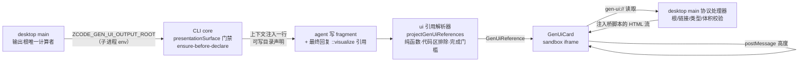

# Spec：会话内联可视化（gen-ui P1，只读渲染链）

任务书 `docs/upstream-port-tasks-20261018.md` T1 的 P1 最小闭环。引入上游
（zai-org v3.15.1 → ZCodium #43 再基线）gen-ui 系统的裁剪版：**不接 MCP Apps**、
不移植 pluginSandbox 凭证体系，先做「fragment → 可视化目录 → 会话内渲染」的
只读可视化链。上游参考（fetch 只读）：`zcodium/main` 的
`packages/shared/src/gen-ui`、`packages/ui/src/gen-ui/domain/references.ts`、
`apps/zcode-cli/.../visualize-plugin`、五份 `docs/specs/gen-ui-*.md`。

## 契约（与上游 wire 格式对齐，不自行发明）

1. **引用格式**：助手最终回复独占一行 `::visualize{"path":"<执行端绝对路径>.html","title"?,"mode":"wide"?}`；
   解析器兼容上游三种历史写法（ASCII JSON 前缀、`::visualize{path="..."}` 参数式、
   Unicode 私用区分隔 JSON），但 schema 只认严格四元组：
   path 为执行端绝对路径、无 `..`、文件名 `[a-z0-9]+(-[a-z0-9]+)*\.html`、≤4096 字符。
2. **输出目录**：根目录由执行 Host 决定，模型永不选择——desktop main 计算
   `<数据目录>/visualizations/`，经 `ZCODE_GEN_UI_OUTPUT_ROOT` 环境变量下发给 CLI host
   进程；子目录 = `sha256(scopeKey)`，scope = `{workspacePath, workspaceIdentity?, sessionId}`。
   CLI 侧 `presentationSurface === "zcode_desktop"` 且 env 存在时才派生；目录创建成功
   才允许向模型声明（ensure-before-declare），失败不静默回落工作区。
3. **安全边界**：
   - 主进程是唯一授权点：读取请求必须命中输出根内、拒绝符号链接/子根链、仅普通文件、
     ≤5MB、文件名符合第 1 条；命中后经 `gen-ui://` 协议流式返回。
   - 渲染 iframe `sandbox="allow-scripts"`（无 allow-same-origin / popups / top-navigation）；
     主进程注入测高桥与滚动条隐藏样式，先于作者脚本执行。
   - P1 允许 fragment 从 CDN 白名单（cdnjs/esm.sh/jsdelivr/unpkg/fonts.*）加载脚本；
     vendored 本地资源域（上游 genUiVendor）推迟到 P2。iframe 内点击外链 P1 不处理。
4. **测高**：guest 是内容测量唯一来源（ResizeObserver+MutationObserver，合帧上报，
   排除根级 script/style/tooltip，vh 等量增量抑制），宿主容器被动跟随，上限 10000px。

## 数据流与所有者

- 输出根：desktop main 唯一计算；目录派生：`packages/shared/src/node/genUiPaths.ts` 纯函数。
- 引用解析：`packages/ui` 纯函数，唯一入口，复用既有 `assistantDirectiveParser`。
- 文件授权：desktop main 协议处理器，不向 renderer 暴露任意文件读取。
- 高度：guest 唯一测量来源；host 不改写文档几何。
- 会话消息里的引用是**文件标识不是读取授权**；fork/重放历史消息重渲染时同路径直读，
  不复制文件、不改写历史。

## 明确不做（P1 范围外）

- MCP Apps / ext-apps SDK / `createSamplingMessage` / widget state / tweak 面板（P2）。
- pluginSandbox 凭证体系、vendored 本地资源域、retained pages 跨重开恢复（P2）。
- 轮尾文件变更摘要的源文件过滤、HTML 网站卡片抑制（上游 file-summary spec，跟随 P2）。
- Web / 手机渲染通路（不新增；Web 端引用按普通文本渲染）。
- 普通终端（TUI/-p）不渲染，但 visualize 技能按上游 loading-boundary 规范只在
  stdio 协议入口加载（移植 `visualize-skill-gate`），避免在无宿主环境产出引用。

## 验收场景

1. desktop 会话让 agent 画图：fragment 落会话输出目录、回复含引用 → 会话内出现
   内联可视化，高度自适应、无横向溢出；同文件二次引用直接复用。
2. CLI 直跑（非 desktop surface）或 env 缺失：上下文不注入目录行，引用按普通文本渲染。
3. 越界路径（`..`/根外/符号链接）、非 html、>5MB、非法文件名：主进程拒绝，渲染错误态卡片。
4. 代码块内的引用、流式未完成的引用：不渲染（分别走代码区排除与完成门槛）。
5. 历史消息重放/fork：同路径文件仍存在则直接渲染；文件已删显示错误态，不崩溃。
6. 主题（深浅色）与 390px 窄屏：卡片布局不溢出；作者片段内滚动区域不受根样式影响。
7. `pnpm typecheck` / `pnpm lint` / 架构门禁全绿；parser、目录派生、主进程校验各有单测。

## 落地注记（2026-10-18，26.2.0 打包版实测后的修复）

首次打包实测（workwin 审计版）暴露两个阻断缺陷，修复约束如下：

1. **visualize 插件必须随桌面包 stage**。`packages/desktop/scripts/official-plugin-stage-list.mjs`
   是打包 stage 清单（原内联在 `prepare-agent-node-bundle.mjs`，现已抽成模块）；漏条目时
   filesystem seed 对解析不到 root 的插件静默跳过，会话里技能不可见且无任何告警。
   `official-plugin-stage-list.test.ts` 守护 definitions↔stage 同步：凡有 listing 的定义
   必须有 stage 条目或显式豁免（运行时 CDN 安装类）。补建 `presentations-plugin`（定义曾
   存在但包从未 vendor，已随本次清理从 definitions 移除）时必须同步加 stage 条目。
2. **presentation surface 是结构性事实，不接灰度**。曾寄生于 desktop-context-prompt 服务端
   灰度（`desktopContextPromptEnabled`），而审计版构建该灰度恒为本地关闭态，`zcode_desktop`
   永不成立 → Interactive views 上下文、输出目录派生、技能门禁全部失效。现 surface 仅由
   Host 装配事实推导（`resolveZCodeAgentPresentationSurface`），desktop-context-prompt 灰度
   机制（rollout、env 链、`ZCODE_DESKTOP_CONTEXT_PROMPT_ENABLED`）整体退役。翻转的副作用：
   Desktop Context 段（Interactive views / Files & URLs / Inline Code Comments）在 desktop
   会话无条件携带；远端执行器仍不带 `ZCODE_GEN_UI_OUTPUT_ROOT`（P1 限定本地工作区，段落里
   显式声明 Gen UI 不可用）。
3. 主进程校验（`genUiFileProtocol.ts`）的单测在 `packages/desktop/tests/genUiFileProtocol.test.ts`，
   覆盖验收场景 3 的全部拒绝路径与桥脚本注入位置。

